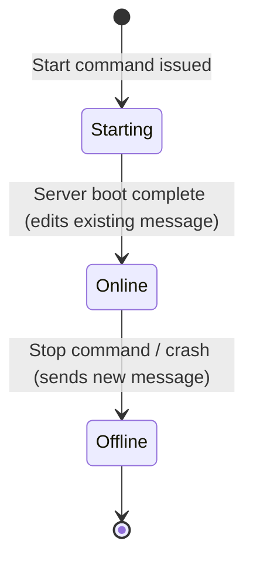

# 🤖 Discord Bot Integration

Beacon features a built-in Discord bot integration using the `discord.js` library, enabling server administrators to monitor status changes and control Minecraft instances directly from Discord.

---

## 🛠️ Bot Configuration Setup

To activate the Discord integration, go to **System Settings > Discord Config** in the panel UI, toggle "Enabled", and configure the credentials:
1.  **Bot Token (`token`):** The private token generated under the "Bot" section in the Discord Developer Portal.
2.  **Client ID (`clientId`):** The application's Client ID from the Discord Developer Portal.
3.  **Guild ID (`guildId`):** The server ID where the slash commands should be registered.

Once saved, the panel backend initializes the client connection and refreshes the application command bindings.

---

## 🕹️ Discord Slash Commands

Beacon registers the following guild commands on startup:

### 1. `/start <server>`
Launches a target Minecraft server instance.
*   **Autocomplete Selection:** The command autocompletes options dynamically, displaying only registered servers that have **Discord Control** enabled.
*   **Operation:** Sends a deferred reply while initiating the Java subprocess, then returns the operation result text.

### 2. `/stop <server>`
Stops a target Minecraft server instance.
*   **Autocomplete Selection:** Same as start, displaying only active servers with Discord Control enabled.
*   **Operation:** Triggers graceful server shutdown (or PID killing if unresponsive) and returns the confirmation message.

---

## 📡 Live Status Embeds

If a server profile has **Discord Status Notification** enabled and is mapped to a valid Discord Channel ID, the bot publishes real-time embedded status cards during power transitions:

### 1. Starting State (`starting`)
*   **Embed Color:** Yellow (`#f1c40f`)
*   **Embed Title:** `⏳ <server_name> is starting...`
*   **Fields:** Version info (if enabled), connection address (if enabled), and clean MOTD lines.
*   **Tracking:** The bot saves the sent message ID (`lastStatusMessageId`) to settings.json.

### 2. Online State (`online`)
*   **Embed Color:** Green (`#2ecc71` or custom color)
*   **Embed Title:** `✅ <server_name> is online`
*   **Optimization (Anti-Spam):** If a `lastStatusMessageId` exists, the bot **edits** the starting message into the online message, keeping the channel clean instead of spamming separate messages.
*   **Fields:** Shows connection address, Minecraft version, custom description, and public modpacks download URLs (if enabled).

### 3. Stopped State (`stop`)
*   **Embed Color:** Red (`#e74c3c`)
*   **Embed Title:** `🛑 <server_name> has stopped`
*   **Fields:** Displays timestamp details.
*   **Tracking:** Clears the saved `lastStatusMessageId` from settings.json.

---

## ⚙️ Embed Customization Settings

Each server can be customized individually in its **Settings** tab:
*   **Show Version (`showVersion`):** Includes the engine version (e.g. `1.20.6`).
*   **Show Connection Address (`showConnectionAddress`):** Embeds the host server IP/Domain and port.
*   **Show MOTD (`showMotd`):** Reads the server's local MOTD configuration, strips Minecraft styling color codes (e.g. `§a`, `§l`), and includes it in the embed.
*   **Show Download Link (`showDownloadLink`):** Appends a link directing players to the panel's public `/download/<server_name>` route to get mod files.
*   **Custom Caption (`customCaption`):** Places custom message text under the description field.
*   **Embed Color (`embedColor`):** Sets the hexadecimal border color of the active online card.
