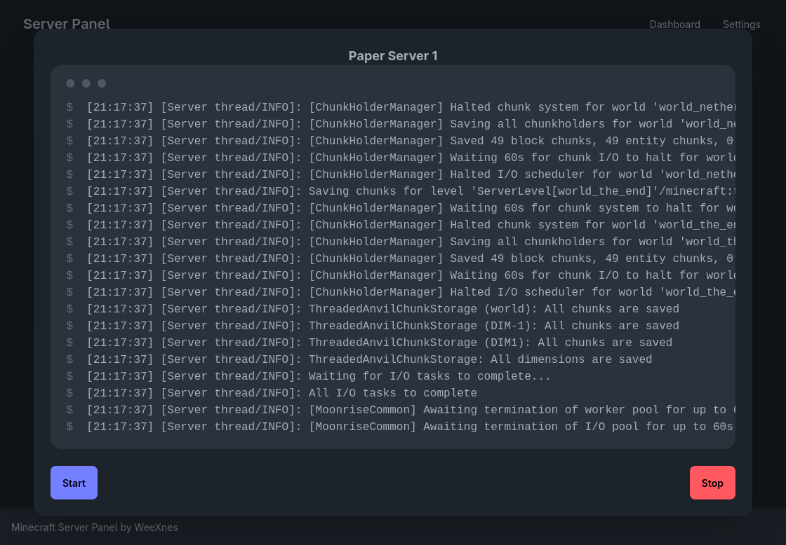

# Beacon

Minecraft server panel built with [Nuxt](https://nuxt.com): manage, configure and watch your servers from the browser.

[](LICENSE)
[](#requirements)
[](#tech-stack)

A Minecraft server manager built for ease of use: live console output via log polling, full server configuration, and
control of every server from your browser.

| | | |
| :-- | :-- | :-- |
|  |  |  |

## Features

- **Manage multiple servers:** add, edit, start and stop Minecraft servers through a web interface.
- **Server configuration:** difficulty, game mode, max players, render/simulation distance, PVP toggle, command blocks, and more.
- **Live console output:** real-time output is streamed by polling the `logs/latest.log` file, with no need for RCON or WebSockets.
- **Password-protected admin access:** protect access to the panel with a configurable admin password.
- **Responsive UI:** a fully responsive dark interface built with Tailwind CSS and Nuxt 3.
- **Persistent settings:** all server configurations are saved and restored between sessions.

### Server configuration options

- **Difficulty:** `peaceful`, `easy`, `normal`, `hard`
- **Game mode:** `survival`, `creative`, `adventure`, `spectator`
- **Slots:** max player count
- **Render distance and simulation distance:** in chunks
- **Booleans:** enable/disable PVP, command blocks, etc.
- **Extras:** upload a custom server banner image

## Requirements

- **Node.js** ≥ 16
- **Java 17+** (for running Minecraft)
- **Minecraft server JAR** (e.g. `paper-1.20.6.jar`)
- **PM2** for process management (optional but recommended)

## Install

```bash
git clone https://code.weexnes.dev/minecraft_server_manager
cd minecraft_server_manager
npm install
```

### Production mode (PM2)

1. Build the app:

   ```bash
   npm run build
   ```

2. Start it with PM2:

   ```bash
   pm2 start
   ```

This uses the configuration in `ecosystem.config.js` to launch the Nuxt server from the build output.

> [!WARNING]
> This panel is intended for local or LAN use. If you host it publicly, use HTTPS with a reverse proxy (e.g. Nginx or Caddy).

## Usage

### Admin password

By default, the admin password is `admin`.

To change it, use the **System Settings** page in the panel, or edit `~/.mcservermanager/settings.json` by hand.

When editing by hand, the password must be a **bcrypt hash**. Generate one for your password with the included script:

```bash
npm run password_gen <your_password>
```

This prints a hash that you can paste into `settings.json`.

## Build from source

### Development mode

```bash
npm run dev
```

### Tech stack

- **Frontend:** [Nuxt 3](https://nuxt.com) + [Tailwind CSS](https://tailwindcss.com)
- **Backend:** Node.js via Nuxt server routes (serving the panel and handling server commands)
- **Real-time console:** filesystem polling of `logs/latest.log` (no need for RCON or WebSockets)
- **Minecraft integration:** designed for vanilla or plugin server JARs (like Spigot or Bukkit)

## License

GPL-3.0. See [LICENSE](LICENSE).
