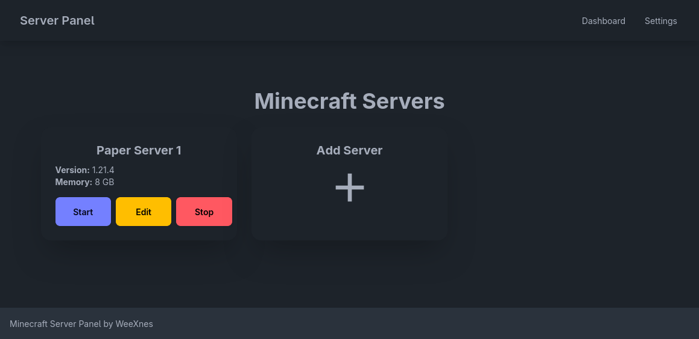
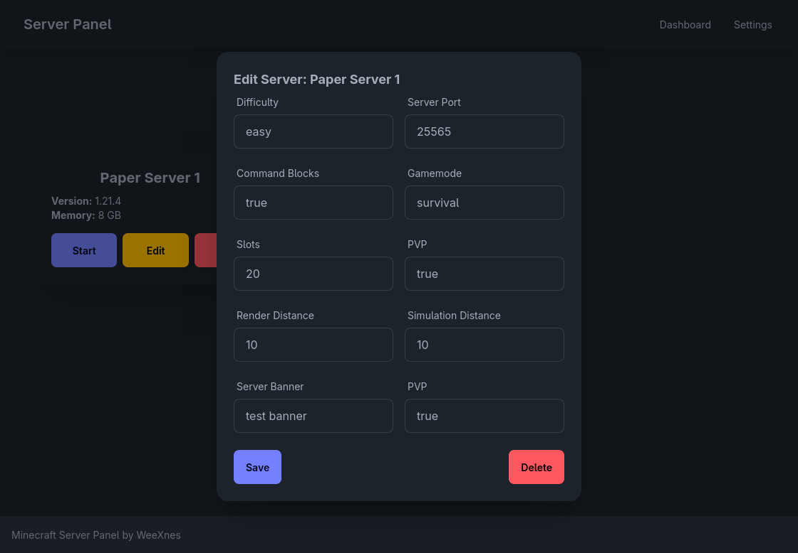

# 🌐 Minecraft Server Panel

A sleek and modern Minecraft server manager built with [Nuxt](https://nuxt.com) for ease of use. Features include live console output via log polling, full server configuration, and intuitive control — all from your browser.

<p align="center">
  
  
</p>

## 🚀 Features

- 🖥️ **Manage Multiple Servers**  
  Add, edit, start, and stop Minecraft servers through a modern web interface.

- 🎮 **Server Configuration**  
  Configure difficulty, game mode, max players, render/simulation distance, PVP toggle, command blocks, and more.

- 📡 **Live Console Output**  
  Real-time output is streamed by polling the `logs/latest.log` file — no need for RCON or WebSockets.

- 🔐 **Password-Protected Admin Access**  
  Protect access to the panel using a configurable admin password.

- 🧭 **Modern UI/UX**  
  Fully responsive dark interface designed with Tailwind CSS and Nuxt 3.

- 💾 **Persistent Settings**  
  All server configurations are saved and restored between sessions.

## ⚙️ Server Configuration Options

- **Difficulty**: `peaceful`, `easy`, `normal`, `hard`
- **Game Mode**: `survival`, `creative`, `adventure`, `spectator`
- **Slots**: Max player count
- **Render Distance** & **Simulation Distance**: In chunks
- **Booleans**: Enable/disable PVP, command blocks, etc.
- **Extras**: Upload a custom server banner image

## 🧪 Tech Stack

- **Frontend**: [Nuxt 3](https://nuxt.com) + [Tailwind CSS](https://tailwindcss.com)
- **Backend**: Node.js via Nuxt server routes (for serving the panel and handling server commands)
- **Real-Time Console**: Filesystem polling of `logs/latest.log` (no need for RCON or WebSockets)
- **Minecraft Integration**: Designed for Vanilla- or Plugin-Server JARs (like Spigot or Bukkit)

## 📦 Getting Started

### Prerequisites

- **Node.js** ≥ 16
- **Java 17+** (for running Minecraft)
- **Minecraft server JAR** (e.g. `paper-1.20.6.jar`)
- **PM2** for process management (optional but recommended)


### Installation

```bash
git clone https://code.weexnes.dev/minecraft_server_manager
cd minecraft_server_manager
npm install
```
#### Development Mode
```bash
npm run dev
```
#### 🔐 Admin Password Setup
By default, the admin password is `admin`.

To change it, you need to edit the `settings.json` file located in `~/.mcservermanager/settings.json`. The password must be a **bcrypt hash**.

You can generate a bcrypt hash for your desired password using the included script:
```bash
npm run password_gen <your_password>
```
This will output a hash that you can copy and paste into the `settings.json` file.


### 🚀 Production Mode (PM2)
1. Build the app:
```bash
npm run build
```
2. Start it with PM2:
```bash
pm2 start
```
This uses the configuration in `ecosystem.config.js` to launch the Nuxt server from the build output.
### 🔒 Security
This panel is intended for local or LAN use If hosting publicly:
- Use HTTPS with a reverse proxy (e.g. Nginx or Caddy)